# 🛰️ НРК / Robotics & Embedded Systems Integration Engineer
## Стенд підготовки до технічної співбесіди (40 Запитань | 8 Модулів | 8 Лабораторних)

---

> [!IMPORTANT]
> **Навчальний фокус:** Безпечні симуляції, телеметрія, сенсори, тестування зв'язку й надійності на **MacBook M3 Max** (Docker, Python 3.12, C++, ESP32 emulators, Linux VM).
> 
> 📁 **GitHub Репозиторій Лабораторних Робіт:**
> [`/Users/oleksiizozulenko/sandbox/github/embedded-robotic-learning-labs`](file:///Users/oleksiizozulenko/sandbox/github/embedded-robotic-learning-labs)

---

## 📌 Прогрес виконання курсу

```mermaid
flowchart LR
    M1["Mod 1: Архітектура"] --> M2["Mod 2: Embedded Linux"]
    M2 --> M3["Mod 3: Networking (Lab 1 ✅)"]
    M3 --> M4["Mod 4: ROS 2"]
    M4 --> M5["Mod 5: MAVLink & PX4/ArduPilot"]
    M5 --> M6["Mod 6: LiDAR & IMU"]
    M6 --> M7["Mod 7: C++/Python (Lab 7 ✅)"]
    M7 --> M8["Mod 8: Testing & HIL Integration"]

    style M3 fill:#2e7d32,stroke:#1b5e20,color:#fff
    style M7 fill:#2e7d32,stroke:#1b5e20,color:#fff
```

| Модуль | Тема | Запитання (5/мод) | Стан Лабораторної |
| :--- | :--- | :---: | :---: |
| **Модуль 1** | Архітектура НРК & Hardware Split | 5 / 5 ✅ | ✅ Готово (`lab01_udp_telemetry`) |
| **Модуль 2** | Embedded Linux & System Diagnostics | 5 / 5 ✅ | 🟡 Підготовлено у репозиторії |
| **Модуль 3** | Networking, Latency & Reliability | 5 / 5 ✅ | ✅ **Завершено (Lab 1)** |
| **Модуль 4** | ROS 2 Architecture, DDS & QoS | 5 / 5 ✅ | 🟡 Підготовлено у репозиторії |
| **Модуль 5** | MAVLink Protocol & Autopilot Stacks | 5 / 5 ✅ | 🟡 Підготовлено у репозиторії |
| **Модуль 6** | LiDAR, IMU & Sensor Fusion | 5 / 5 ✅ | 🟡 Підготовлено у репозиторії |
| **Модуль 7** | C++ & Python Concurrency / Backpressure | 5 / 5 ✅ | ✅ **Завершено (Lab 7)** |
| **Модуль 8** | Integration Testing & Fault Injection | 5 / 5 ✅ | 🟡 Підготовлено у репозиторії |

---

## 📚 Повний курс: Мінілекції, Корисні посилання та Q&A (40 Запитань)

---

### 🔹 Модуль 1. Архітектура НРК

#### 📖 Мінілекція
Наземні робототехнічні комплекси (НРК) та автономні системи будуються за принципом двоієрархічного розділення задач:
1. **Low-level (Hard Real-Time):** Мікроконтролер або автопілот (STM32, ESP32, Pixhawk). Завдання: обробка IMU (400–1000 Гц), PID-стабілізація моторів, опитування енкодерів, аварійне зупинення (Watchdog). Затримка відгуку має бути строго підпорядкована дедлайну (< 1-2 мс).
2. **High-level (Soft Real-Time / Non-Real-Time):** Companion Computer (NVIDIA Jetson, Raspberry Pi 5, Intel NUC). Завдання: побудова карти та локалізація (SLAM), обробка point clouds з LiDAR, комп'ютерний зір, ROS 2 nodes, планування шляху (A*, TEB Local Planner), телеметрія та мережевий зв'язок.

#### 🔗 Корисні посилання
- [PX4 Companion Computer Guide](https://docs.px4.io/main/en/companion_computer/pixhawk_companion.html)
- [ArduPilot Companion Computers Overview](https://ardupilot.org/dev/docs/companion-computers.html)
- [CAN Bus Protocol Tutorial & Specifications](https://www.can-cia.org/can-knowledge/)

#### 💬 Запитання та Відповіді
1. **Що таке companion computer і чим відрізняється від controller?**
   - *Companion computer* — високорівневий одноплатний ПК (Linux/ROS 2) для обчислювально складних задач (SLAM, AI, Vision, Network).
   - *Controller / MCU* — мікроконтролер для hard real-time задач стабілізації та безпосереднього керування приводами.
2. **Як виглядає архітектура мобільного робота?**
   - Сенсори високого потоку (LiDAR, камери) → Companion Computer.
   - Сенсори стабілізації (IMU, енкодери, концевики) → MCU / Controller.
   - Зв'язок між CC та MCU: UART (MAVLink/Micro-XRCE-DDS) або CAN bus.
3. **Чим відрізняються UART, CAN, SPI, I²C, Ethernet?**
   - *UART:* асинхронний Point-to-Point (до 3-6 Mbps, до 2-5 м).
   - *CAN:* децентралізована диференційна шина з пріоритезацією за ID (1-8 Mbps, до 40 м).
   - *SPI:* синхронний full-duplex на короткі відстані на платі (10-100+ Mbps).
   - *I²C:* двопровідна шина з адресацією (100 kbps - 3.4 Mbps).
   - *Ethernet:* високошвидкісна пакетна мережа (100 Mbps - 10 Gbps) для LiDAR та відео.
4. **Як запускається embedded Linux?**
   - `ROM Code` → `Bootloader (U-Boot)` → `Linux Kernel` (ініціалізація DTB та rootfs) → `Init system (systemd, PID=1)`.
5. **Як забезпечити модульність при заміні hardware?**
   - Через Hardware Abstraction Layer (HAL), стандартизовані ROS 2 типи повідомлень (`sensor_msgs`, `nav_msgs`) та динамічне завантаження драйверів через конфігураційні YAML-файли та плагіни (`pluginlib`).

---

### 🔹 Модуль 2. Embedded Linux

#### 📖 Мінілекція
Embedded Linux забезпечує операційне середовище Companion Computer. Запуск починається з завантажувача U-Boot, який передає ядру Linux файл **Device Tree (.dtb)** — текстову/бінарну карту периферії SoC. Процес `systemd` (PID=1) відповідає за підняття мереж, монтаж файлових систем та керування робототехнічними демонами за допомогою юніт-файлів з автоматичним перезапуском при падіннях (`Restart=always`).

#### 🔗 Корисні посилання
- [Linux Device Tree Architecture (kernel.org)](https://www.kernel.org/doc/Documentation/devicetree/usage-model.txt)
- [systemd.service Documentation](https://www.freedesktop.org/software/systemd/man/latest/systemd.service.html)
- [eLinux Embedded Linux Wiki](https://elinux.org/Main_Page)

#### 💬 Запитання та Відповіді
1. **Що таке Device Tree?**
   - Це структура даних, що описує апаратну конфігурацію плати (GPIO, адреси регістрів, IRQ, шини SPI/I²C), відокремлюючи описання заліза від коду ядра Linux.
2. **Як знайти USB-UART адаптер?**
   - `lsusb`, `dmesg | grep -i tty`, перевірка `/dev/ttyUSB*` або `/dev/ttyACM*`. Закріплення імені здійснюється через **udev rules** (`/etc/udev/rules.d/`).
3. **Як працюють systemd service і restart policy?**
   - Юніт-файл описує команду запуску (`ExecStart`) та правила перезапуску (`Restart=always`, `RestartSec=3s`). При аварії сервісу systemd піднімає його автоматично.
4. **Чим відрізняються process і thread?**
   - *Process* має власну ізольовану віртуальну пам'ять. *Thread* живе всередині процесу і ділить спільну пам'ять Heap з іншими потоками.
5. **Як діагностувати зависання застосунку?**
   - `htop` (перевірка CPU/RAM), `gdb -p <PID>` (`thread apply all bt` для аналізу блокувань), `strace -p <PID>` (аналіз системних викликів).

---

### 🔹 Модуль 3. Networking

#### 📖 Мінілекція
Надійність мережевого зв'язку — критичний фактор для телеметрії та безпеки робота. Роботи використовують UDP для передачі потокової телеметрії, відео та даних сенсорів (мінімальний оверхед, відсутність Head-of-Line blocking), а TCP — для гарантованої доставки команд або оновлень. У разі роботи через нестабільні бездротові канали (Wi-Fi, 4G/5G, Mesh) оцінюються Latency, Jitter, Packet Loss та Bandwidth, а захищений канал забезпечується WireGuard VPN.

#### 🔗 Корисні посилання
- [Beej's Guide to Network Programming](https://beej.us/guide/bgnet/)
- [WireGuard VPN Protocol Paper](https://www.wireguard.com/papers/wireguard.pdf)
- [IETF RFC 768 - User Datagram Protocol](https://datatracker.ietf.org/doc/html/rfc768)

#### 💬 Запитання та Відповіді
1. **Switch vs router?**
   - *Switch (L2)* об'єднує пристрої в межах однієї LAN за MAC-адресами. *Router (L3)* маршрутизує пакети між різними мережами за IP-адресами.
2. **TCP vs UDP?**
   - *TCP* гарантує доставку та порядок пакетів через підтвердження (ACK). *UDP* передає датаграми без встановлення з'єднання з мінімальною затримкою.
3. **NAT, DHCP, subnet mask?**
   - *DHCP* автовидає IP-адреси; *Subnet mask* розділяє мережеву та хостову частини IP; *NAT* транслює внутрішні IP робота у зовнішню IP-адресу.
4. **VPN vs фізичний канал?**
   - Фізичний канал має найнижчу затримку, але обмежену радіус-дію. VPN (WireGuard) створює шифрований оверлейний тунель поверх будь-яких публічних мереж.
5. **Latency, jitter, packet loss, bandwidth?**
   - *Latency:* затримка в мс. *Jitter:* коливання затримки. *Packet loss:* % втрачених пакетів. *Bandwidth:* пропускна здатність (Mbps).

---

### 🔹 Модуль 4. ROS 2

#### 📖 Мінілекція
ROS 2 (Robot Operating System) базується на стандарту **DDS (Data Distribution Service)**. Модулі робота оформлюються як **Nodes**, що спілкуються через:
- **Topics (Publish/Subscribe):** асинхронний потік даних (телеметрія, сенсори).
- **Services (Request/Response):** синхронний виклик "запит-відповідь" (тривалістю декілька мс).
- **Actions (Goal/Feedback/Result):** довготривалі асинхронні завдання з проміжним фідбеком (наприклад, навігація в точку).

#### 🔗 Корисні посилання
- [ROS 2 Official Tutorials (Humble/Jazzy)](https://docs.ros.org/en/humble/Tutorials.html)
- [ROS 2 Quality of Service (QoS) Deep Dive](https://docs.ros.org/en/humble/Concepts/Intermediate/About-Quality-of-Service-Settings.html)
- [REP 105 - Coordinate Frames for Mobile Robots](https://www.ros.org/reps/rep-0105.html)

#### 💬 Запитання та Відповіді
1. **Node, topic, publisher/subscriber?**
   - *Node* — виконний процес/модуль; *Topic* — пойменований канал даних; *Publisher* надсилає дані у топік, *Subscriber* зчитує їх.
2. **Services vs actions?**
   - *Service* використовується для швидких синхронних запитів. *Action* — для довгих задач з можливістю скасування та зворотним зв'язком (Feedback).
3. **DDS і QoS?**
   - DDS забезпечує P2P комунікацію. *QoS (Quality of Service)* налаштовує надійність (`Reliable` vs `Best Effort`) та збереження (`History`, `Durability`).
4. **Навіщо timestamps і frame_id?**
   - `stamp` фіксує час отримання вимірювання для часової синхронізації в EKF; `frame_id` вказує систему координат сенсора (`base_link`, `laser_frame`, `map`).
5. **Як діагностувати відсутні ROS 2 повідомлення?**
   - `ros2 topic list`, `ros2 topic echo`, `ros2 topic hz`, перевірка неспівпадіння QoS профілів (`ros2 topic info --verbose`), перевірка RMW (`RMW_IMPLEMENTATION`).

---

### 🔹 Модуль 5. MAVLink, PX4, ArduPilot

#### 📖 Мінілекція
**MAVLink** — легковаговий бінарний протокол (заголовок 8-14 байт) для зв'язку між автопілотом та Companion Computer. Кожен вузол має **System ID** (ідентифікатор борту) та **Component ID** (автопілот, камера, companion). **HEARTBEAT** надсилається щосекунди для сповіщення про наявність борту та його поточний режим. **PX4** та **ArduPilot (ArduRover)** — провідні відкриті стеки автопілотів.

#### 🔗 Корисні посилання
- [MAVLink Developer Guide](https://mavlink.io/en/)
- [PX4 Autopilot User Guide](https://docs.px4.io/)
- [ArduRover Modes Documentation](https://ardupilot.org/rover/docs/rover-control-modes.html)

#### 💬 Запитання та Відповіді
1. **Що таке MAVLink?**
   - Це бінарний протокол з серіалізацією повідомлень для роботи по низькошвидкісних радіоканалах та UART.
2. **Що таке system ID/component ID?**
   - *System ID* визначає конкретний робот/борт (наприклад, ID=1); *Component ID* визначає підсистему всередині робота (ID=1 Autopilot, ID=194 Companion).
3. **Навіщо HEARTBEAT?**
   - Повідомляє про стан з'єднання, тип платформи, автопілот та активний режим керування. При зникненні HEARTBEAT вмикається Failsafe.
4. **PX4 vs ArduPilot/ArduRover?**
   - *PX4* має більш модульну POSIX-подібну архітектуру (uORB middleware). *ArduPilot/ArduRover* має величезну базу підтримки заліза та перевірені алгоритми для наземних систем.
5. **Концептуальні відмінності Manual, Guided, Auto, Hold?**
   - *Manual:* пряме керування оператором. *Guided:* рух у вказану точку з Companion Computer/GCS. *Auto:* виконання заздалегідь завантаженого місійного маршруту. *Hold:* утримання поточної позиції.

---

### 🔹 Модуль 6. LiDAR, IMU & Sensor Fusion

#### 📖 Мінілекція
- **IMU (Inertial Measurement Unit):** містить акселерометр (лінійне прискорення) та гіроскоп (кутова швидкість). Дані інтегруються для розрахунку орієнтації (Roll, Pitch, Yaw). Для уникнення Gimbal Lock використовуються **Кватерніони** ($q = [w, x, y, z]$).
- **LiDAR:** генерує хмару точок (Point Cloud) шляхом вимірювання часу прольоту лазерного променя (ToF).
- **Sensor Fusion:** Комплементарний або Розширений фільтр Калмана (EKF) об'єднує високочастотні дрифтуючі дані IMU з точними, але менш частотними даними LiDAR/GPS.

#### 🔗 Корисні посилання
- [PCL - Point Cloud Library Documentation](https://pointclouds.org/documentation/)
- [An Introduction to the Kalman Filter (UNC)](https://www.cs.unc.edu/~welch/media/pdf/kalman_intro.pdf)
- [REP 103 - Standard Units of Measure and Coordinate Conventions](https://www.ros.org/reps/rep-0103.html)

#### 💬 Запитання та Відповіді
1. **LiDAR і point cloud?**
   - LiDAR вимірює відстань до об'єктів. Point cloud — масив точок у 3D просторі $(X, Y, Z, I)$, де $I$ — інтенсивність відбиття.
2. **Accelerometer vs gyroscope?**
   - *Accelerometer* вимірює лінійні прискорення та вектор гравітації (дрейфує при русі). *Gyroscope* вимірює кутову швидкість (дрейфує з часом при інтегруванні).
3. **Roll, pitch, yaw, quaternion?**
   - Roll/Pitch/Yaw — кути Ейлера (наочні, але мають проблему Gimbal Lock при 90° Pitch). Кватерніон — 4-компонентне векторне представлення обертання без сингулярностей.
4. **Навіщо калібрування й синхронізація?**
   - Калібрування прибирає zero-offset bias та температурний дрейф. Синхронізація (Hardware Trigger / PTP / NTP) гарантує узгодженість часових міток різних сенсорів.
5. **Sensor fusion і Kalman filter?**
   - Алгоритм оцінки стану, який оптимально поєднує вимірювання з різних сенсорів з урахуванням коваріації їхніх шумів.

---

### 🔹 Модуль 7. C++ / Python Concurrency & Backpressure

#### 📖 Мінілекція
Обробка телеметрії високої частоти вимагає ефективної роботи з потоками виконання. При розбіжності швидкості генерації даних (Producer) та їх обробки (Consumer) виникає переповнення пам'яті. Для вирішення цієї проблеми застосовується **Backpressure** та обмежені черги (**Bounded Queues**) з політикою витіснення застарілих даних (`DROP_OLDEST`). Для безпеки використовуються концепції RAII, Smart Pointers (`std::unique_ptr`), Mutex та `asyncio`.

#### 🔗 Корисні посилання
- [C++ Reference Threading & Concurrency](https://en.cppreference.com/w/cpp/thread)
- [Python asyncio Documentation](https://docs.python.org/3/library/asyncio.html)
- [C++ Core Guidelines (RAII & Smart Pointers)](https://isocpp.github.io/CppCoreGuidelines/CppCoreGuidelines)

#### 💬 Запитання та Відповіді
1. **Thread, mutex, message queue?**
   - *Thread* — потік виконання. *Mutex* — примітив взаємного виключення для захисту спільних даних. *Message queue* — структура для передачі повідомлень між потоками.
2. **Race condition і deadlock?**
   - *Race condition:* невизначеність результату при одночасному доступі потоків до пам'яті без синхронізації. *Deadlock:* взаємне взаємоблокування потоків, які чекають на ресурси один одного.
3. **asyncio і неблокувальний I/O?**
   - Однопотокова асинхронна модель на основі Event Loop, яка дозволяє обробляти тисячі сокетів/I/O операцій без затрат на перемикання контексту потоків.
4. **RAII та smart pointers?**
   - *RAII (Resource Acquisition Is Initialization):* техніка, де ресурс зв'язується з часом життя об'єкта. Smart pointers (`std::unique_ptr`, `std::shared_ptr`) автоматично звільняють пам'ять при виході з області видимості.
5. **Backpressure і bounded queue?**
   - *Bounded queue* обмежена за розміром. *Backpressure* — стратегія обробки переповнення (дроп нових/старих повідомлень або сповільнення Producer'a), що запобігає Out-Of-Memory (OOM).

---

### 🔹 Модуль 8. Testing та Інтеграція

#### 📖 Мінілекція
Розробка НРК вимагає поетапної піраміди тестування:
- **Unit Tests:** перевірка окремих функцій, парсерів та алгоритмів.
- **Integration Tests:** перевірка взаємодії декількох нод/модулів у Docker Compose.
- **HIL (Hardware-in-the-Loop) / SIL (Software-in-the-Loop):** тестування реального або симульованого автопілота в замкненому контурі.
- **Fault Injection:** штучне внесення мережевих затримок, обриву зв'язку та некоректних даних для перевірки спрацювання **Watchdog** та **Failsafe** сценаріїв.

#### 🔗 Корисні посилання
- [Google Test (gTest) Documentation](https://google.github.io/googletest/)
- [Docker Compose Architecture & Documentation](https://docs.docker.com/)
- [Chaos Engineering Principles & Fault Injection](https://principlesofchaos.org/)

#### 💬 Запитання та Відповіді
1. **Unit/integration/system/HIL tests?**
   - *Unit:* ізольовані тести коду. *Integration:* перевірка зв'язку модулів. *System:* тестування всього стека. *HIL:* тестування коду на реальному залізі з фізичними емуляторами сенсорів.
2. **Як тестувати втрату з'єднання?**
   - Ін'єкцією збоїв через `tc qdisc` (Traffic Control у Linux), розривом сокету у Docker, або емулятором з відсотком drop rate (як у Lab 1).
3. **Watchdog, health check, heartbeat?**
   - *Watchdog:* апаратний/програмний таймер, який перезапускає систему, якщо його не "годують". *Health check:* перевірка статусу сервісу. *Heartbeat:* періодичний сигнал наявності вузла у мережі.
4. **Як організувати observability?**
   - Логування (`spdlog`/`rclcpp::logging`), збір метрик (Prometheus, OpenTelemetry), візуалізація стану системних ресурсів та каналів зв'язку (Grafana).
5. **Як інтегрувати незнайоме обладнання?**
   - 1) Вивчення даташиту та специфікації протоколу (UART/CAN/Ethernet). 2) Запис сирих логів (Hex dump/pcap). 3) Написання ізольованого драйвера/парсер з Unit-тестами. 4) Обгортка у ROS 2 Node та проведення HIL-тестів.
